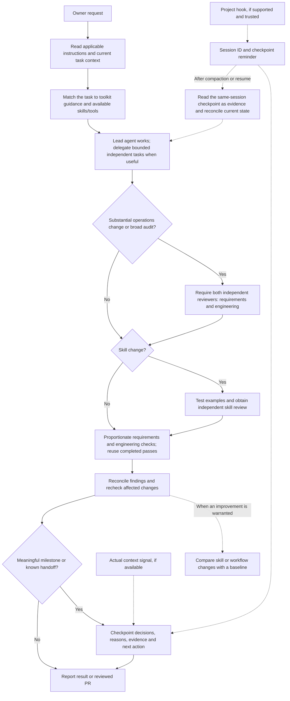

# Studio workflow and knowledge

October 28, 2026. The owner authorized implementation after selecting these defaults: interview substantial planning/design changes; save confirmed project decisions and confirm wider preferences; consult references and saved design preferences only on request; research public sources before evaluating Apollo; review releases weekly and before substantial work without automatically switching models. These choices supersede the earlier automatic design-retrieval suggestion.

## Task flow

This is the intended workflow in a supported host, not proof that every client exposes the same tools or enforced gates. Categories can overlap; [WORKFLOW.md](../WORKFLOW.md) owns the detailed review requirements.



## Interviews and persistent decisions

`.agents/skills/studio-grilling/SKILL.md` owns the interview method. It is an EVZ adaptation rather than a vendored upstream skill. Read it automatically for substantial planning/design changes, or on an explicit grilling request. Direct small changes proceed normally. Confirmed implementation decisions belong in BRIEF.md/TASKS.md; private client decisions belong in that client's existing notes/work/asset feedback, never a new public client folder. Save the reason and the deciding answer alongside acceptance criteria. Chat summaries are not the durable record.

Use existing project feedback for likes/dislikes and retain source asset/version, quote, actor and date. Automatic scope is project-only even for Always/Never wording. Explicitly selecting studio scope is confirmation. Historical automatically broadened feedback stays unchanged on disk but is projected back to its source project; an unbound legacy global rule is withheld until scope is confirmed. Existing explicitly studio-scoped rules remain shared. Conflicts never imply permission to replace an approved baseline.

Optional preference recall is on request, not an extra required research step before every design. Ordinary project packets withhold optional history and its automatic application; an opaque history hash still invalidates stale work when relevant saved context changes. Confirmed studio standards, approved assets, feedback attached to the exact asset/version selected for the current refinement, restrictions and stale-context checks remain required task constraints. Do not use the request-only setting to bypass an approved baseline or an unresolved dispute. Current packet hashes change with this source revision: re-read/reconcile in-flight authoring work before execution rather than replaying old approvals.

## Requested reference and preference recall

The shared reference index is `docs/design-references.json`: public URLs, tags, use cases and limitations. It intentionally stores pointers and original analysis rather than copied third-party assets or client information. To add a useful reference, verify its source and rights, then add an entry through the normal PR workflow. Keep client-specific selections and the reasons in the client's existing private output/source or notes, rather than labeling a shared entry as a client's preference.

From the repository root:

```powershell
node scripts/studio-context.mjs references "animation reduced-motion"
node scripts/studio-context.mjs preferences C:\private\authorized-workspace "Exact existing company name"
```

The second command explicitly opts into the existing lifecycle project packet and returns only the selected client's preference plan and approved assets. The existing authenticated HTTP routes also support `GET /desk/api/project-context/PROJECT?preferences=1` or `/desk/api/project-resolve?name=EXACT_NAME&preferences=1` (omit `/desk` locally). Ordinary calls omit history. No second client store, original-file fetch or approval is created. Run only after the owner requests recall, using an authorized workspace/session and exact company identity; ambiguity holds. Output is private, including any shell log containing it. Use `.agents/skills/studio-design-vault/SKILL.md` for interpretation and same-record writeback. Never check client output into Git.

The existing continuation skill still reads current work, original assets and mandatory constraints. It no longer asks agents to proactively consult optional saved preferences. Codex discovers repo skills in `.agents/skills`; CLAUDE.md points to the same sources for clients needing an explicit entry. Other agents should read AGENTS.md and load the skill directly if their discovery differs. This is portable instruction support, not proof of execution in every hosted client or transfer of connector permissions.

## Public research and Apollo evaluation

November 1 release update: the owner cancelled the Apollo subscription and approved removing active launch dependencies while preserving historical receipts. New discovery profile capture no longer performs the automatic identity query. The historical evaluation/optional queue instructions below do not authorize new Apollo use for this release. Task/outbound dependencies still need migration; cancellation alone does not complete that work. See the current release task in TASKS.md.

Use existing public search, business-controlled websites/profiles and reviewed directories first. Keep current source dates, business identity, usable general business routes and unknowns explicit. The contact queue reaches review without an Apollo request. An Apollo outage cannot prevent recording that public result. Do not claim that a generic shop number is owner-direct or that missing public evidence proves a business problem.

Apollo remains installed for its existing task/outbound dependencies. Free identity search is optional after an identified public-source gap, not a default stage. To enable one bounded free identity query for an unfinished contact card, first finish its public reads and inspect `queue.json`. Then prepare a private review JSON containing `prospect_id`, `public_evidence_sha256` = lifecycle `hash({pages:item.pages,search:item.search})`, `reviewed_by`, current ISO `reviewed_at`, `gap` (specific missing identity/contact information), and `approval_ref`. Run:

```powershell
node pipeline/owner-contact-cli.mjs queue-enable-apollo C:\private\operations C:\private\contact-queue C:\private\gap-review.json
```

The existing queue runner performs at most its one identity read; no enrichment or phone reveal is enabled. Changed bindings/public evidence or a review older than 24 hours invalidate the grant. A fresh evidence review can replace an unused expired grant while retaining the old grant in history; it cannot reset a started, uncertain or completed provider attempt. Public page capture does not open a connector; the supervised/CLI queue connects lazily only for search or a permitted provider query and retains connection failures honestly. For direct public capture, `collect` is public-only; use the queue for an explicit provider gap. Do not replay an old immutable capture to add Apollo or reset exhausted/uncertain work. Credit-consuming enrichment keeps its existing exact confirmation/reservation rules.

Evaluate a small paired sample from existing authorized records before a retention decision. For each business retain public findings, source review, minutes and usable route; separately review Apollo's additional unique professional route, lookup effort and credits. A provider match or availability flag alone is not additional usable access. Report source freshness, wrong matches and missing screening; do not erase unsuccessful attempts. Use existing receipts when possible, then authorize any new credit-consuming sample through the established boundary.

`node scripts/studio-context.mjs apollo-evaluation C:\private\paired-observations.json` summarizes 1–151 reviewed observations. Each row has a unique private `id`, booleans `public_reviewed`, `apollo_reviewed`, `public_usable`, `apollo_additional_usable`, nonnegative numeric `public_minutes`, `apollo_minutes`, `credits`, and `additional_evidence` explaining any extra reviewed utility. Only aggregate counts/costs are printed. No new live trial or subscription cancellation follows from this command. Subscription cost, follow-up/task dependencies and migration effort are separate parts of the owner's keep/remove decision; historical provider results are not an unbiased paired benchmark.

Historical starting evidence in OWNER-CONTACTS.md: the 151-card public pass found eight published identities and one explicitly owner-linked business number; the selected 36-person enrichment batch retained 21 typed numbers on 19 businesses, including a duplicate and a DNC hold. These are different populations and provider-reported candidates, with missing screening, not a paired comparison of usable access. Initial recommendation: stop default enrichment, preserve the existing task/outbound dependencies, and decide retention using reviewed additional utility rather than raw match counts. No current Apollo balance, plan cost or new paired live outcome was established here.

## Model updates and learned procedures

`.agents/skills/studio-model-review/SKILL.md` owns weekly and substantial-work checks; `docs/model-review.md` holds dated public recommendations. Monday 9 AM America/New_York is the chosen implementation default for the requested weekly check. Notify only for a relevant change, failure or needed decision. No model change, new inference allowance or purchase is automatic.

During authorized work, agents may create or improve an EVZ skill and test it with independent review. Start with a concrete repeated success, failure, or explicit request; inspect existing skills and prefer a narrow update or executable check when it fits. State the intended trigger, exclusions, evidence, scope, and why a skill is useful. A one-off client preference stays project-scoped and does not automatically become a studio rule. Use the installed `skill-creator` when available; its structural validator checks packaging, not whether the skill improves outcomes. If unavailable, use the [Agent Skills specification](https://agentskills.io/specification) and inspect names, descriptions, references and any scripts directly.

Before relying on a new or changed skill, compare realistic fictional examples with the relevant baseline, including an explicit trigger, a natural trigger, and a nearby case that should not trigger. Check actual decisions and artifacts against independently specified expectations; note false positives, misses, available usage and time. Keep candidate and baseline conditions comparable and use held-out cases when practical. An independent reviewer examines the exact skill revision, permissions, dependencies and observed evidence; see [WORKFLOW.md](../WORKFLOW.md#review-and-pr-evidence). Record what was changed, why, the reviewed revision, results and limitations in the existing task/PR or private client record. If behavior, discovery or independent review is unverified, say so; structural validation alone is not proof of improvement. Recheck on a relevant upstream or environment change and retain a rollback path. [Evaluation cases and recipe](agent-workflow-evaluation.md) provide the initial fictional baseline.

Keep one owner for a shared-file change and let that owner integrate fixes. Discussion/read-only work can reuse the current checkout. Use a separate existing suitable worktree for independent concurrent edits when needed; a new chat alone is not a reason to create one. Archive only worktrees created for the task once needed work is preserved.

## Adoption and verification

No new dependency or external catalog installation is needed. Awwwards MCP remains unadopted pending commercial-use/content terms and a demonstrated need beyond existing references/browser tools. Agent Reach remains unadopted pending an actual source gap and account/session handling review. Its open-source license does not establish permission or reliability for every underlying site. Consult TOOLKIT.md before either adoption.

Verified October 28: 92 focused/integration checks passed with zero failures/skips using `node --test scripts/studio-context.test.mjs scripts/build-desk-assets.test.mjs pipeline/design-preferences.test.mjs pipeline/contact-queue.test.mjs pipeline/owner-contacts.test.mjs pipeline/project-work.test.mjs pipeline/project-authoring.test.mjs pipeline/project-continuation.test.mjs pipeline/lifecycle.test.mjs pipeline/hosted-desk.test.mjs`. The separate serial suite covering `project-assets.test.mjs`, `shared-project-originals.test.mjs`, `hosted-authoring.test.mjs`, `refinement-generation.test.mjs` and `shared-project-continuation.test.mjs` passed. Pipeline syntax, all three new skills' Skill Creator validation and diff checks passed. Codex's active-session skill catalog now exposes the new repo skills; fresh Claude/Cursor execution is not claimed.

Requirements review checked the latest requested-only retrieval choice, scoped memory, public-first default, recommendation-only model reviews and preservation of staging work. Engineering review identified and corrected eager connector startup, renewal of unused invalidated grants, real packet-level history withholding and request context stability. Regressions cover those cases, signed local/hosted recall, exact-client ambiguity, unchanged client records and provider no-repeat rules.

These checks do not establish deployment, real prospect research quality, cross-provider model quality or a completed Apollo value comparison. Roll back source through the PR/feature branch without rewriting client records; old authoring claims require reconciliation after a context-shape change. Pause the separate `evz-weekly-model-release-review` app heartbeat if withdrawing the weekly behavior. Never reset existing research/provider attempts as rollback.
